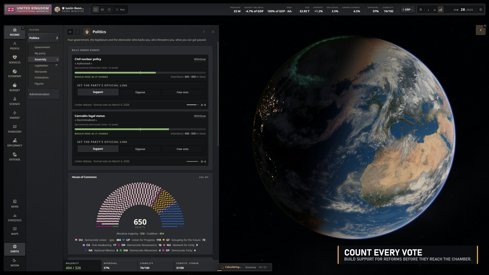
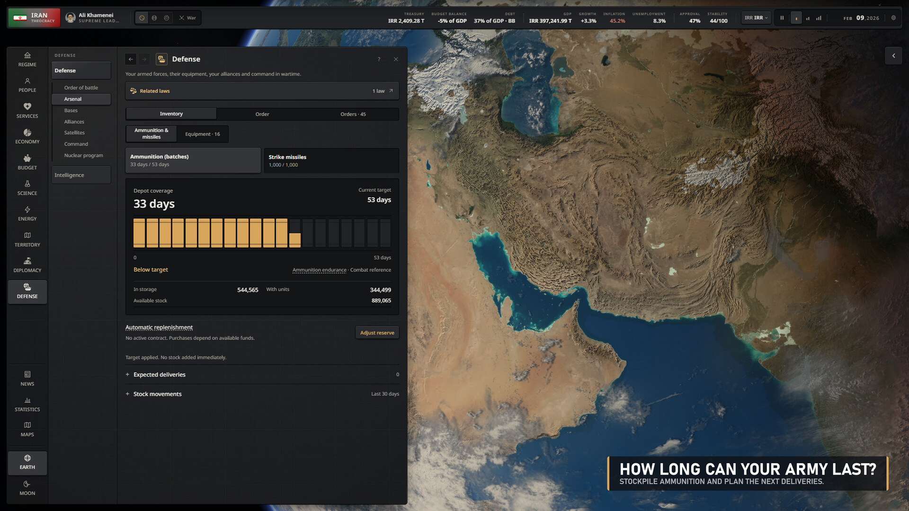
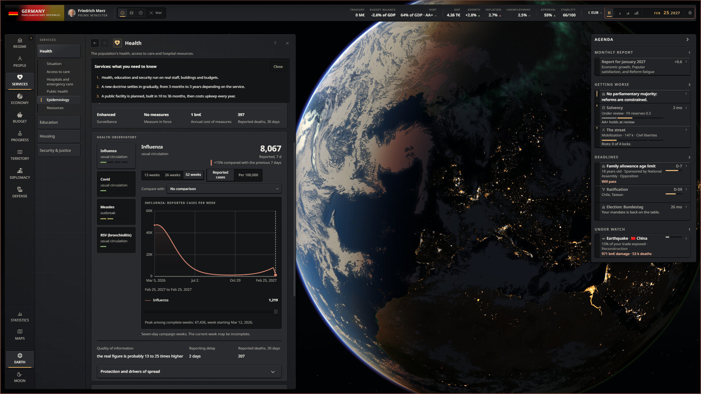
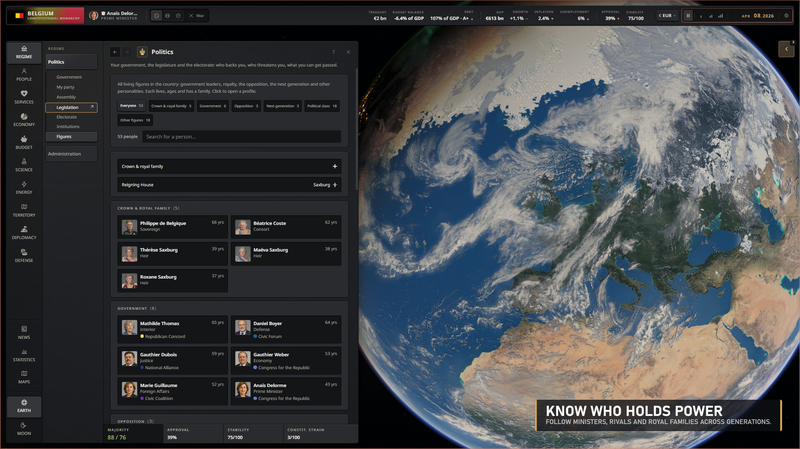
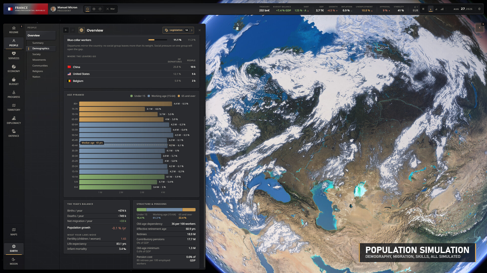
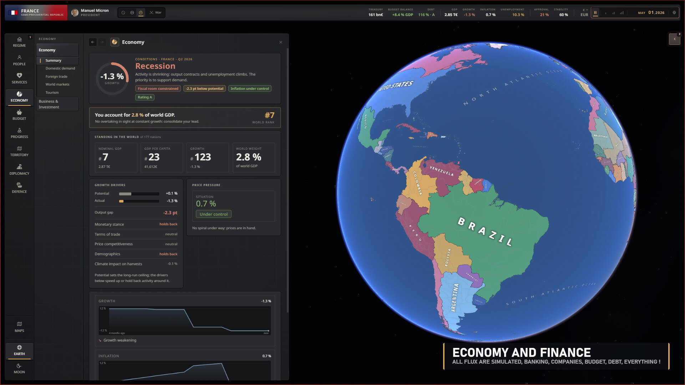
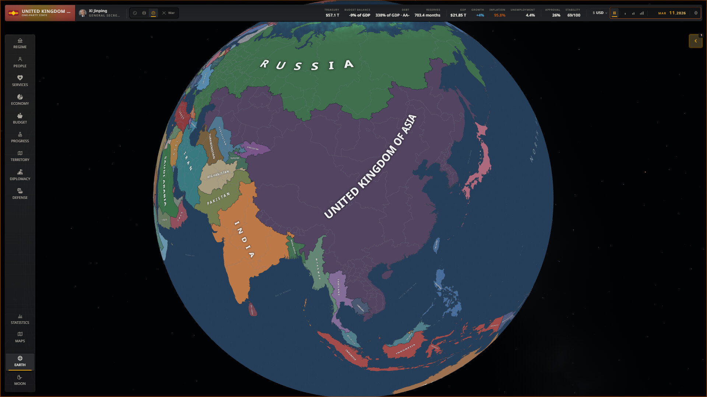

# MANDATIA — Direção Visual e Arquitetura de Interface

**Referência estética:** Geoplanetical / simuladores geopolíticos de gestão nacional  
**Plataforma prioritária:** Windows  
**Idioma da interface:** Português do Brasil (PT-BR)  
**Resolução-base atual do projeto:** 1280 × 720, proporção 16:9  
**Etapa solicitada:** análise e definição visual — **não implementar ainda**

---

## INSTRUÇÃO PRINCIPAL AO AGENTE

Atue como diretor de arte e designer sênior de interfaces para jogos de estratégia política, com experiência em UI de alta densidade informacional e em projetos Godot.

Quero reformular a identidade visual do **Mandatia** para aproximá-la da linguagem visual das imagens de referência anexadas, especialmente da composição de interface de **Geoplanetical**: globo ou mapa-múndi como cenário permanente, painéis escuros sobrepostos, navegação lateral compacta, barra superior de indicadores nacionais e informações organizadas em cartões, listas, gráficos e tabelas.

As imagens anexadas são referências de **linguagem visual, composição, hierarquia, densidade e navegação**. Não copie os textos, números, países, personagens, logotipos ou dados exibidos nelas. Não tente reproduzir o jogo de referência literalmente. O Mandatia deve manter sua própria identidade, seus sistemas e suas funcionalidades.

### Regra obrigatória desta etapa

**Não altere nenhum arquivo nesta fase.** Não edite `scripts/ui`, `scripts/main.gd`, `scripts/aurora_board.gd`, temas, cenas, recursos `.tres`, configurações ou assets. Não renomeie, mova, exclua ou crie arquivos dentro do projeto.

Primeiro, inspecione a estrutura existente e apresente uma proposta visual fundamentada no que realmente existe no projeto. Aguarde aprovação explícita antes de implementar qualquer alteração.

Não invente funcionalidades, indicadores, telas, dados ou recursos que não estejam implementados ou planejados no Mandatia. Quando uma ideia depender de algo que ainda não existe, identifique-a como **sugestão futura**, separada do escopo atual.

---

# 1. Identidade visual pretendida

O Mandatia é um simulador de gestão política e institucional. A interface deve transmitir:

- autoridade institucional e seriedade;
- leitura rápida de indicadores econômicos, políticos e sociais;
- sensação de administrar um país em escala nacional e internacional;
- profundidade geográfica, com o mundo como cenário visual;
- grande quantidade de informação sem aparência de planilha genérica;
- navegação consistente entre sistemas complexos.

A inspiração deve vir de simuladores geopolíticos modernos: uma interface predominantemente escura, compacta, funcional e informativa, com o mapa ou globo ocupando grande parte da tela.

### Evitar expressamente

- estética sci-fi, cyberpunk, holográfica ou futurista;
- neon azul/ciano, brilhos intensos e contornos luminosos;
- painéis com aparência de HUD de nave espacial;
- grandes cartões vazios, excesso de espaço sem função ou botões gigantes;
- gradientes chamativos, sombras exageradas e animações decorativas;
- aparência de dashboard SaaS genérico;
- excesso de cantos arredondados;
- textos grandes demais para uma interface de estratégia com muitos dados.

A interface deve parecer um **centro de comando político e administrativo**, não um painel de ficção científica.

---

# 2. Leitura das imagens de referência

Use os sete arquivos da pasta `referencias/` em conjunto. Cada imagem demonstra uma parte diferente da linguagem desejada.

## Referência 01 — Política, projetos de lei e hemiciclo

Observe a barra superior com indicadores compactos, a navegação em duas camadas à esquerda, os cartões de projetos de lei, as barras de intenção de voto e o hemiciclo com assentos coloridos por bancada. Esta é a referência principal para Congresso, eleições, legislação e composição parlamentar.

## Referência 02 — Defesa e arsenal

Observe a organização de inventário, abas, cartões numéricos, barras segmentadas de estoque, estados de alerta e controles de ajuste. A informação é densa, mas dividida em blocos legíveis.

## Referência 03 — Saúde, indicadores e agenda

Observe os gráficos históricos, filtros temporais, indicadores resumidos, painel de agenda à direita e alertas com prazos. A tela combina um painel principal de análise com uma coluna secundária de acontecimentos.

## Referência 04 — Pessoas, governo e figuras políticas

Observe a busca e os filtros por grupos, cartões de pessoas com retrato, nome, idade, função e vínculo político, além da separação por categorias institucionais. Use este padrão em telas de governo, partidos, lideranças e figuras públicas quando houver dados equivalentes no Mandatia.

## Referência 05 — Demografia e estrutura populacional

Observe a pirâmide etária horizontal, os agrupamentos por faixa de idade, as métricas de nascimentos, mortes e migração e os cartões de estrutura populacional. A visualização deve priorizar comparação e leitura dos dados.

## Referência 06 — Economia e finanças

Observe o resumo de conjuntura econômica, a classificação internacional, os indicadores em cartões, os fatores de crescimento, a inflação e os gráficos históricos. O globo/mapa permanece visível ao fundo e ajuda a dar contexto geográfico à simulação.

## Referência 07 — Globo e mapa político

Observe o globo em grande escala, a iluminação discreta, as fronteiras nacionais, os nomes dos países e as cores territoriais. O mapa é parte importante da identidade visual e não deve parecer apenas uma imagem decorativa colocada atrás da interface.

### Princípio de interpretação

Não é necessário que todas as telas exibam exatamente a mesma composição. A regra é manter uma linguagem unificada: **globo/mapa como cenário, navegação compacta, painéis de informação escuros e indicadores acessíveis**. A quantidade e a posição dos painéis podem variar conforme a função de cada tela.

---

# 3. Arquitetura visual da tela

A composição deve se aproximar das referências, abandonando a ideia de uma sidebar larga ocupando 220 px e uma página convencional dividida em 12 colunas.

## 3.1. Cenário geográfico

- O globo ou mapa-múndi deve ocupar a área de fundo da experiência principal do jogo, sempre que a estrutura atual do projeto permitir.
- O cenário geográfico deve continuar visível mesmo quando painéis estiverem abertos.
- Os painéis devem ser sobrepostos ao cenário, em vez de transformar toda a tela em uma página opaca que elimina o mapa.
- O país selecionado, fronteiras, regiões ou áreas relevantes podem receber destaque visual discreto, conforme os recursos já existentes.
- O mapa deve ter contraste suficiente para ser reconhecido, mas não pode competir com textos e indicadores.
- Quando a tela não precisar de contexto geográfico, ela poderá priorizar um painel amplo, mantendo o mesmo sistema visual.

**Restrição técnica:** antes de propor um globo 3D, verifique como o projeto representa o mundo atualmente. Não introduza dependências, serviços externos, novos sistemas de renderização ou grandes assets sem apresentar a necessidade e aguardar aprovação. Se o projeto atual não suportar um globo 3D viável, apresente uma alternativa coerente com os recursos disponíveis, como mapa 2D interativo ou mapa estilizado.

## 3.2. Barra superior global

Criar uma barra horizontal fina, fixa no topo durante a experiência de jogo, inspirada nas referências.

Ela deve reunir, conforme os dados que já existirem no projeto:

**Lado esquerdo:**
- bandeira ou identificador do país;
- nome do país e regime político;
- retrato/identificação do chefe de governo ou chefe de Estado, quando aplicável;
- partido ou cargo, se disponível.

**Área central:**
- tesouro ou saldo disponível;
- resultado orçamentário;
- dívida pública;
- PIB e crescimento;
- inflação;
- desemprego;
- aprovação;
- estabilidade política ou institucional.

**Lado direito:**
- controles de velocidade/pausa da simulação, se já existirem;
- data atual do jogo;
- acesso a configurações ou opções globais, se já existirem.

Não force todos os indicadores em resoluções menores. Defina prioridades, abreviações claras, tooltips e/ou uma forma de consultar os indicadores secundários sem poluir a barra. Não invente valores para preencher espaços.

## 3.3. Navegação principal — primeira faixa lateral

Substitua a sidebar larga por uma faixa vertical estreita, inspirada na primeira coluna das referências.

- Largura de referência em 1280 × 720: aproximadamente **58–68 px**.
- Ícones simples, monocromáticos e reconhecíveis.
- Rótulos curtos abaixo dos ícones ou ao lado, conforme o espaço disponível.
- Estado ativo destacado por uma linha, fundo ou pequeno marcador em âmbar.
- Estados inativos em cinza médio.
- Separação visual entre grupos de navegação.

Preserve os grupos de navegação que já existem no `main.gd`, atualmente organizados em:

1. PAÍS
2. PODER
3. ECONOMIA
4. MUNDO
5. REGISTRO

Não crie uma nova taxonomia sem antes mapear os módulos atuais. A nomenclatura pode ser refinada na proposta, mas a organização funcional existente deve ser respeitada.

## 3.4. Navegação contextual — segunda faixa lateral

Ao lado da navegação principal, use uma segunda coluna estreita para mostrar as subseções do grupo selecionado.

- Largura de referência em 1280 × 720: aproximadamente **105–135 px**.
- Fundo grafite ligeiramente diferente do painel principal.
- Itens alinhados verticalmente, com espaçamento compacto.
- Item selecionado com fundo sutil e marcador âmbar.
- Títulos de grupo pequenos e discretos.
- Submenus devem refletir as telas realmente existentes.

A navegação contextual não deve ocupar espaço excessivo nem repetir informações já presentes no título do painel.

## 3.5. Painel principal de conteúdo

O conteúdo da tela deve aparecer em um painel sobreposto ao globo/mapa, normalmente ancorado à esquerda, depois das duas faixas de navegação.

- Largura de referência em 1280 × 720: aproximadamente **380–500 px**, ajustável de acordo com a tela.
- Fundo grafite escuro, opaco ou com transparência muito discreta.
- Borda fina e sutil; sem brilho externo.
- Rolagem vertical interna quando necessário.
- Cabeçalho com ícone de seção, título, navegação de retorno e ações contextuais.
- Cartões, tabelas, gráficos e listas organizados em blocos compactos.

O painel não deve cobrir o globo inteiro. A área geográfica precisa continuar formando uma parte importante da composição.

## 3.6. Painel secundário à direita

Um painel de agenda, notificações, acontecimentos ou prazos pode aparecer no lado direito quando a tela justificar.

- Deve ser opcional e contextual, não obrigatório em todas as telas.
- Deve ser mais estreito que o painel principal.
- Deve priorizar alertas, eventos próximos, decisões pendentes e acontecimentos importantes.
- Não deve sobrepor informações geográficas ou dados essenciais sem necessidade.

---

# 4. Grid, proporções e adaptação de resolução

A resolução lógica atual do projeto é **1280 × 720**. Preserve essa referência nesta etapa, mas não construa uma interface que dependa rigidamente de coordenadas fixas.

Use proporções, containers, âncoras e regras de adaptação compatíveis com o sistema de UI já usado no projeto Godot.

### Proporções iniciais para orientar o estudo

| Elemento | Referência em 1280 × 720 |
|---|---:|
| Barra superior | 38–46 px de altura |
| Navegação principal | 58–68 px de largura |
| Navegação contextual | 105–135 px de largura |
| Painel principal | 380–500 px de largura |
| Painel secundário opcional | 180–230 px de largura |
| Margens internas dos painéis | 10–16 px |
| Espaçamento entre blocos | 8–12 px |

Essas medidas são referências iniciais, não limites absolutos. Faça a proposta considerando o espaço ocupado pelo globo e a legibilidade dos dados.

### Comportamento responsivo

- Em 1280 × 720, a barra superior e os painéis precisam permanecer legíveis.
- Em janelas menores, a navegação contextual pode recolher ou aparecer como painel expansível.
- O painel principal pode reduzir sua largura, mas não deve comprimir gráficos e tabelas até ficarem ilegíveis.
- Em resoluções maiores, aproveite o espaço adicional para revelar mais do mapa e ampliar áreas de análise, não apenas aumentar todos os elementos.
- Evite rolagem horizontal, salvo em tabelas cuja natureza realmente exija isso.

Não adote um grid fixo de 12 colunas como regra universal. Use uma composição baseada em regiões funcionais: navegação, painel de dados, cenário geográfico e painel contextual opcional.

---

# 5. Paleta de cores — grafite institucional e âmbar

A paleta atual de `mandato_theme.gd` deve ser avaliada e harmonizada com a linguagem das referências. A proposta abaixo é a direção preferencial: menos azul-marinho, menos ciano e mais grafite neutro com âmbar moderado.

| Token | Cor sugerida | Aplicação |
|---|---|---|
| `BG` | `#090A0C` | Fundo global e áreas sem conteúdo |
| `SURFACE` | `#17191C` | Painéis e navegação contextual |
| `SURFACE_RAISED` | `#202226` | Cards, caixas e menus elevados |
| `SURFACE_HOVER` | `#292C31` | Hover e seleção discreta |
| `LINE` | `#34373D` | Bordas, separadores e grades |
| `TEXT` | `#E7E7E7` | Texto principal |
| `MUTED` | `#A0A2A6` | Legendas e texto secundário |
| `SUBTLE` | `#70747A` | Metadados e elementos inativos |
| `AMBER` | `#DDAA4D` | Ação primária, seleção e destaque institucional |
| `RED` | `#D87575` | Alertas críticos e indicadores negativos |
| `GREEN` | `#79B88A` | Indicadores positivos e sucesso |
| `INFO` | `#7FAFC0` | Informação neutra e dados auxiliares |

### Regras de cor

1. O fundo deve ser quase preto ou grafite, não azul-marinho saturado.
2. O âmbar é a cor de destaque principal, usado com moderação.
3. Ciano/azul não deve dominar a navegação ou o tema geral.
4. Vermelho e verde devem comunicar estados, não decorar componentes.
5. Não use uma cor saturada em grandes áreas de fundo.
6. Evite gradientes coloridos e efeitos de brilho.
7. Garanta contraste adequado entre texto, cards e fundo.
8. Unifique os tokens em um único tema; não mantenha duas paletas concorrentes entre `mandato_theme.gd` e `screen_factory.gd`.

### Cores políticas e partidárias

As cores dos partidos e das bancadas são dados de identidade política e devem continuar distinguíveis entre si. Não force todos os partidos a usar apenas as cores do tema geral.

- Se já houver cores partidárias definidas no projeto, preserve-as e avalie apenas saturação, contraste e consistência de apresentação.
- Se a lógica atual do hemiciclo usa os três eixos RED/CYAN/AMBER, preserve essa associação nesta etapa, mas mantenha essas cores restritas à representação ideológica e a indicadores relacionados.
- Não use a cor partidária como cor de textos longos ou de grandes painéis.

---

# 6. Tipografia

Use exclusivamente as famílias que já existem no projeto. Não adicione fontes externas.

| Função | Família / recurso | Uso |
|---|---|---|
| Corpo e dados | **Figtree** — `ui_regular.tres`, `ui_medium.tres`, `ui_bold.tres` | Textos, tabelas, botões, valores e indicadores |
| Títulos | **Sora** — `generic_title.tres`, `generic_heading.tres`, `generic_eyebrow.tres`, `generic_menu.tres` | Títulos de tela, seções e navegação |
| Fallback CJK | **Noto Sans SC** — recursos `noto_sans_sc_*.tres` | Glifos de fallback já previstos no projeto |

### Escala recomendada para a interface compacta

| Nível | Tamanho de referência | Uso |
|---|---:|---|
| Micro/metadata | 10–11 px | Unidades, datas auxiliares e metadados |
| Legenda | 11–12 px | Rótulos de gráficos, notas e indicadores secundários |
| Corpo | 12–14 px | Texto principal, listas, tabelas e botões |
| Título de card | 13–15 px | Cabeçalhos de blocos e cartões |
| Título de seção | 16–20 px | Cabeçalho do painel ou seção |
| Título de tela | 21–26 px | Título principal da área |
| Métrica destacada | 22–30 px | Indicadores de maior importância |

Use Sora com parcimônia, principalmente nos títulos. Use Figtree para leitura prolongada e grandes quantidades de dados.

Não reduza textos essenciais a tamanhos ilegíveis. Em 1280 × 720, informações relevantes devem continuar legíveis sem depender de zoom.

---

# 7. Componentes e padrões de interface

Padronize os componentes abaixo, respeitando os sistemas já implementados.

## Cards de indicadores

- Fundo `SURFACE_RAISED`.
- Borda fina em `LINE`.
- Título pequeno e discreto.
- Valor numérico com maior peso visual.
- Variação positiva/negativa indicada por cor sem depender apenas dela; use também sinal, texto ou ícone.
- Evite cards excessivamente grandes ou com muito espaço vazio.

## Tabelas e listas

- Cabeçalhos compactos e alinhados.
- Separadores sutis.
- Linhas alternadas apenas quando melhorarem a leitura.
- Valores numéricos alinhados para facilitar comparação.
- Destaque de seleção e hover discreto.
- Ordenação, filtros e busca somente quando já previstos ou aprovados para implementação.

## Gráficos

- Fundo escuro, grade discreta e linhas finas.
- Legenda legível e unidades explícitas.
- Cores limitadas e consistentes.
- Períodos e filtros temporais organizados acima ou abaixo do gráfico.
- Não adicionar efeitos 3D, brilhos ou animações sem função informativa.

## Botões e abas

- Botões compactos e retangulares, com cantos pouco arredondados.
- Ação primária em âmbar, com texto escuro ou de alto contraste conforme o teste de legibilidade.
- Ação secundária em `SURFACE_RAISED`, com borda sutil.
- Estados de hover, foco, pressionado e desabilitado claramente distintos.
- Abas devem parecer controles institucionais, não botões de aplicativo mobile.

## Alertas e notificações

- Use vermelho somente para risco ou situação crítica.
- Use âmbar para prazo, atenção ou decisão pendente.
- Use verde para conclusão ou condição positiva.
- Inclua texto explicativo; não dependa apenas de um pequeno ponto colorido.

## Retratos e pessoas

- Utilize os assets de retrato existentes em `assets/aurora/`, quando adequados.
- Padronize enquadramento, tamanho e posição do retrato.
- Mostre nome, cargo, partido e demais dados que já existirem.
- Não gere retratos fictícios nem associe uma pessoa a um cargo sem dados do jogo.

---

# 8. Telas prioritárias

A proposta deve respeitar as telas e os módulos reais encontrados no projeto. A tabela abaixo define a direção visual desejada, não autoriza criar sistemas novos.

| Tela / módulo | Direção visual |
|---|---|
| **Menu inicial** | Identidade do Mandatia, fundo escuro, composição limpa e opções de novo jogo/carregar/configurações. Não precisa forçar o layout completo de gameplay. |
| **Dashboard do país** | Globo/mapa em destaque, barra superior com indicadores nacionais e painel de resumo com métricas e acontecimentos. |
| **Congresso / hemiciclo** | Painel de política e legislação, composição parlamentar, bancadas, maioria, oposição, votações e projetos em discussão. |
| **Governo** | Lista de ministérios, responsáveis, partidos, cargos e promessas, com cartões compactos e hierarquia institucional. |
| **Economia e orçamento** | Indicadores macroeconômicos, receitas, despesas, dívida, resultado fiscal e gráficos históricos, conforme os dados existentes. |
| **População / demografia** | Estrutura etária, população, migração e outros dados demográficos que já existirem, usando gráficos de comparação. |
| **Serviços públicos** | Saúde, educação, habitação e demais áreas existentes, com indicadores, evolução e alertas. |
| **Defesa** | Inventário, capacidades, orçamento, prontidão e dados militares existentes, usando painéis e barras de estoque quando aplicáveis. |
| **Mundo / diplomacia / território** | Globo ou mapa como foco, países e regiões selecionáveis e painéis contextuais com informações disponíveis. |
| **Notícias / registro / histórico** | Feed cronológico compacto, datas, categoria do evento e consequências registradas no jogo. |
| **Resultado / avaliação** | Síntese visual da legislatura ou partida, indicadores finais, evolução e resultado político. |

### Regra de consistência

Todas as telas devem compartilhar a mesma barra superior, navegação principal, navegação contextual, tratamento de painéis, tipografia e paleta. O conteúdo interno pode mudar, mas a interface deve continuar reconhecível.

---

# 9. Hemiciclo e composição parlamentar

O hemiciclo existente é desenhado em `scripts/aurora_board.gd`. A proposta deve respeitar sua lógica antes de sugerir alterações.

### O que preservar nesta etapa

- As cinco fileiras atuais.
- O mapa de oito regiões, caso continue fazendo parte da lógica existente.
- A representação de assentos por parlamentar/bancada.
- A associação atual entre partidos, eixos ideológicos e cores.
- Os dados reais de cadeiras, maioria e composição parlamentar.

### Direção visual

- Arcos concêntricos de assentos, formando um semicírculo legível.
- Bancadas agrupadas de acordo com a organização política real do jogo.
- Assentos pequenos, mas distinguíveis em 1280 × 720.
- Mesa da presidência discreta no centro superior do hemiciclo.
- Legenda compacta abaixo ou ao lado, sem competir com o gráfico.
- Maioria, oposição, independentes e total de cadeiras destacados em cartões auxiliares.
- Assento selecionado com contorno claro, sem brilho exagerado.
- Votação em andamento indicada por âmbar de forma sutil.
- Informações detalhadas do parlamentar exibidas em tooltip ou painel contextual, caso esse comportamento já exista ou seja aprovado.

O hemiciclo deve lembrar uma visualização parlamentar profissional, não um gráfico decorativo. Não altere a lógica de cálculo ou distribuição dos assentos durante a etapa de direção visual.

---

# 10. Movimento, interação e acabamento

A interface deve responder rapidamente, mas sem animações chamativas.

- Transições curtas entre painéis e subseções.
- Hover discreto em itens clicáveis.
- Feedback claro ao selecionar país, partido, parlamentar, indicador ou seção.
- Tooltips para siglas, unidades e informações complementares.
- Rolagem previsível dentro dos painéis.
- Nenhum efeito sonoro ou visual deve ser presumido nesta etapa.

Priorize estabilidade, legibilidade e feedback funcional. Animação é secundária.

---

# 11. Auditoria obrigatória do projeto antes da proposta

Antes de sugerir alterações, inspecione o projeto e mapeie:

1. Como `scripts/main.gd` organiza menu, gameplay, telas e navegação.
2. Quais componentes estão em `scripts/ui/` e como são instanciados.
3. Como `scripts/ui/mandato_theme.gd` define cores e estilos.
4. Como `screen_factory.gd` define ou sobrescreve estilos.
5. Como `scripts/aurora_board.gd` desenha o hemiciclo e recebe os dados parlamentares.
6. Quais recursos de fontes `.tres` estão disponíveis e onde são usados.
7. Quais assets existem em `assets/aurora/` e quais podem ser aproveitados.
8. Qual é o sistema atual de mapa/globo e se já existe renderização geográfica utilizável.
9. Quais indicadores e informações realmente estão disponíveis nos dados do jogo.
10. Quais limitações de resolução, containers, âncoras ou componentes podem afetar o layout.

Não assuma que os nomes dos arquivos descrevem integralmente seu funcionamento. Leia as implementações e rastreie como os componentes se conectam.

---

# 12. Entregáveis desta etapa — sem modificar o projeto

Depois da auditoria, apresente uma proposta objetiva contendo:

### A. Diagnóstico do visual atual

- O que já está alinhado com as referências.
- O que conflita com a direção desejada.
- Quais estilos estão duplicados ou competindo.
- Quais elementos podem ser reaproveitados.

### B. Sistema visual proposto

- Tokens finais de cor.
- Escala tipográfica.
- Dimensões e proporções da barra superior e das duas faixas de navegação.
- Larguras sugeridas dos painéis.
- Regras de cards, tabelas, gráficos, botões, alertas e estados.

### C. Wireframes textuais

Apresente pelo menos três composições em 1280 × 720:

1. Dashboard do país com globo/mapa visível.
2. Política/Congresso com hemiciclo e painel de votação.
3. Economia ou demografia com painel analítico e mapa ao fundo.

Os wireframes devem identificar as regiões da tela, a hierarquia dos componentes e como o mapa permanece visível.

### D. Plano técnico de implementação

Liste os arquivos que provavelmente precisariam ser alterados, explicando o motivo e o impacto esperado. Separe mudanças de tema, componentes, layout, hemiciclo e mapa. Não faça essas mudanças ainda.

### E. Riscos e decisões pendentes

Aponte limitações técnicas reais, dependências, dados ausentes e decisões que precisam de aprovação. Não esconda limitações e não proponha substituir sistemas funcionais sem justificativa.

---

# 13. Critérios de aprovação visual

A proposta só estará alinhada quando cumprir estes pontos:

- [ ] A interface lembra um simulador geopolítico institucional, não um jogo sci-fi.
- [ ] O globo/mapa é parte central da composição durante a gestão do país.
- [ ] A barra superior reúne indicadores e controles sem ficar visualmente pesada.
- [ ] A navegação principal é estreita e a navegação contextual ocupa uma segunda faixa.
- [ ] Os painéis são compactos, escuros e organizados por função.
- [ ] O grafite/preto predomina; o âmbar funciona como destaque principal.
- [ ] Figtree, Sora e Noto Sans SC existentes são preservadas.
- [ ] Os dados continuam legíveis em 1280 × 720.
- [ ] O hemiciclo preserva a lógica parlamentar já implementada.
- [ ] A identidade visual é consistente entre todas as áreas.
- [ ] Nenhuma funcionalidade ou dado foi inventado.
- [ ] Nenhum arquivo do projeto foi alterado nesta etapa.

**Ao concluir, pare e aguarde minha aprovação. Não implemente automaticamente a proposta.**
